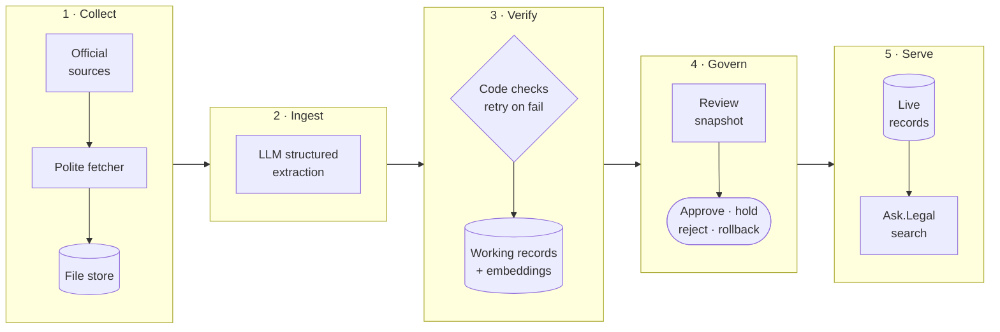

<div align="center">

<picture>
  <source media="(prefers-color-scheme: dark)" srcset="assets/logo-dark.svg">
  
</picture>

### The law, noted up every moment.

noteup is a **continuous legal intelligence engine**. Instead of a static snapshot, it
treats the law as a living stream: new legislation, amendments and judgments are ingested
as they're published, read by **frontier large language models**, **verified against the
source**, and woven into a **semantically searchable knowledge base** in which every
authority carries its own up-to-date history. Humans stay in the loop: nothing goes live
without approval. Built for **Ask.Legal**.

     


[Why noteup](#why-noteup) · [What it does](#what-it-does) · [Coverage](#coverage) · [Applications](#applications) · [Architecture](#architecture) · [Engineering](#engineering-highlights) · [Roadmap](#roadmap)

</div>

> [!NOTE]
> This repository is a showcase of a private project. The source code isn't public. I'm happy
> to walk through it on request.

---

## Why noteup

The law doesn't stand still. Sections are amended, new judgments are handed down every
day, and cases that were good law last year are doubted or overruled. Lawyers call
checking for this *noting up*. Done by hand, it's slow and easy to miss.

Legal search tools and AI assistants have the same problem, only silently. A database
built once starts going out of date the next day, and an assistant that confidently
cites a repealed section or an overruled case is worse than one that says nothing.

noteup was built for **Ask.Legal**, to keep its Hong Kong legal search database current. It
does the noting up for a whole database, continuously:

- **Continuously current.** New legislation, amendments and judgments are ingested as
  they're published, and made searchable by meaning, not just keywords.
- **History-aware.** Every authority knows what has happened to it since: amended,
  followed, doubted or overruled.
- **Human-in-the-loop.** AI does the reading, people sign off, and every change is
  reversible.

## What it does

**For legislation**

- Keeps every provision up to date, in each official language.
- Reads newly published amendments to work out what changes and when, and warns when an
  amendment has come into force but the official consolidated text hasn't caught up yet,
  so nobody relies on wording that has already changed.

**For case law**

- Uses natural language processing to turn each judgment into its legal points: the
  issue, the proposition, how it was applied, and whether it was necessary to the decision
  or said in passing.
- Backs every point with the court's own words and paragraph numbers, checked word for
  word against the judgment.
- Recognises how later judgments treat earlier ones, and links each treatment to the
  exact point affected:

| When a later judgment… | noteup… |
|---|---|
| follows, applies or approves a point | notes it, e.g. *Applied in X v Y at [55].* |
| doubts, criticises or disapproves it | adds a warning to the point |
| overrules or reverses it | keeps the point, marks it **not in force**, and says why |
| distinguishes it | leaves it as it is |

Overruled law isn't deleted. Your search can leave it out by default and still show a
case's full history when it's needed.

**Human-in-the-loop governance**

- A review report shows every proposed change side by side with what's live now.
- Reviewers approve in batches, hold back anything doubtful, and settle the few cases
  the model couldn't decide.
- A published update can be rolled back in one step.

## Coverage

| Jurisdiction | Legislation | Case law | Status |
|---|---|---|---|
| Hong Kong | Ordinances and subsidiary legislation, with amendment warnings | Court of Final Appeal, Court of Appeal, Court of First Instance | Running daily |
| Other common law jurisdictions | — | — | Planned |

noteup is built so a new jurisdiction is a new set of sources, not a new system: the
records, the treatment rules and the review all stay the same.

## Applications

noteup provides the data layer: current, structured, verified law with semantic
embeddings. These are some of the applications it is designed to support.

**For lawyers**

- **Semantic legal search.** Ask in plain language, for example *"When can a tenant withhold
  rent for disrepair?"*, and get the relevant provisions and case points, in English or
  Chinese.
- **Citator.** Look up a case or section and see everything that has happened to it since.
- **Authority checking.** Scan a submission, opinion or contract for authorities that have
  since been overruled, repealed or amended.
- **Current awareness.** Alerts when the law changes in a practice area, or in the law a
  client relies on.
- **Research memos.** First drafts grounded in current law, with pinpoint citations.
- **Precedent by facts.** Each point records the facts needed to understand it, so you can
  search by situation, not just by doctrine.

**For legal technology and in-house teams**

- **Retrieval-augmented generation (RAG).** Ground LLM assistants in current law, with
  citations to the exact paragraph and warnings that keep them from relying on bad law.
- **Regulatory change tracking.** What changed in the rules that matter to you, and when
  it takes effect.
- **Case law analytics.** Which points are most followed, which are doubted, and how
  authority flows between courts.
- **Comparative law.** As coverage grows, how different common law jurisdictions answer
  the same question.

## Architecture



One Python program and one Postgres database, run daily by a systemd timer. Two commands
do the work: `sync` talks only to the official websites, and `read` does all the LLM work
on what was saved. A website outage and an LLM usage limit never block each other, and
either step can stop at any point and pick up where it left off.

### What you get

One record per provision or legal point, in Postgres with pgvector:

| Field | |
|---|---|
| `text` | The provision or point with its context, ready to embed and show |
| `authority_note` | Warnings and treatment notes. Pass it to your model alongside `text` |
| `in_force` | `false` for overruled or reversed points. Filter on it in search |
| `id`, `source`, `type`, `jurisdiction` | Stable ID (`hk-leg:cap622g:s5`, `hk-case:2024-hkcfa-12:para48`), link to the official source, and where it applies |

Embeddings are created for you, so records are ready for semantic search. LLM output is
never trusted as is: it's checked against the source before it becomes a record, and
published text only changes through an approved review.

### Workflow

```bash
noteup sync      # collect what's new from the official sources (no LLM calls)
noteup read      # extract with the LLM, check, build records and embeddings
noteup status    # runs, failures, what's waiting, usage and spend

noteup review start      # freeze the changes and write a side-by-side report
noteup review approve    # publish them (or hold, reject, rollback)
```

A systemd timer runs `sync` and `read` every night.

## Engineering highlights

### Trusting LLM output only after code has checked it

LLM answers use strict JSON schemas, and nothing becomes a record until code has verified it:

- every quote appears **word for word** in the paragraph it cites (after whitespace
  normalisation);
- every statute and earlier case the model names appears in the judgment as written;
- every paragraph number exists, and every record fits the 7,000-token limit.

A failed check gets one retry, with the reason fed back and the exact paragraph repeated
for the model to copy from. A second failure marks the judgment "couldn't process" for a
person to see. Downloaded text is passed to the model as clearly delimited data and never
as instructions, which guards against prompt injection from source documents.

### Semantic deduplication with reasoning fingerprints

Batches of near-identical judgments (779 right-of-abode appeals in one year, for example)
would waste LLM budget and flood search with duplicates. noteup fingerprints each
judgment's reasoning, masking party names and incidental numbers but keeping statutory
references, so applying a different section is never a match. Each group is read once
through a representative, which carries a note that the same reasoning was applied in N
other judgments. Translations, corrigenda, sentencing remarks and short orders are set
aside before any LLM call.

### A rule-grounded AI citator

Each treatment is resolved by neutral citation, case number or law-report citation. Fixed
rules decide the effect: a note for *followed / applied / approved*, a warning for
*doubted / criticised / disapproved*, and *not in force* for *overruled / reversed*, but
only when the court can do it (the CFA, or a higher court than the one that decided the
point). The LLM chooses the affected point from an enum of real record IDs, so it can't
invent one. Anything unclear goes to a reviewer, not into search.

### Stable identity across re-reads

Record IDs come from the first paragraph a point quotes (`hk-case:2024-hkcfa-12:para48`),
so re-reading a judgment after a prompt change updates records in place rather than
replacing them. That keeps review diffs small and meaningful, and lets holds and treatments
stay attached.

### Transactional, reversible publishing

- A review is frozen in **one SQL statement**, so it is a consistent snapshot even while a
  sync is writing.
- Holds are keyed to a record's **version hash**: a hold lapses automatically if the record
  changes again.
- Approve and rollback each run in **one transaction**, with a change-set hash for the
  audit trail. Rollback refuses if a later review touched the same records.
- **Database roles** enforce the boundary: the sync role cannot write the live table at all.

### Autonomous, budget-aware operation

- A Postgres **advisory lock** prevents overlapping runs.
- An **LLM response cache** keyed on prompt version, model and input makes re-runs free.
- **Spending and usage caps** stop reading cleanly and resume on the next run.
- **Reading hours** confine LLM calls to a nightly window.
- Judgments are read **newest first**, so the most useful law arrives first while the
  historical backlog works through.
- A run log and a `status` command show runs, failures, backlog, usage and spend at a glance.


## Quality

- **73 tests** run against a real Postgres database, with saved source pages and recorded
  LLM answers, so they're fast, deterministic and free.
- A **hand-checked golden set** of judgments measures extraction quality (points and
  treatments matched, missed and extra), re-run whenever a prompt or model changes.
- Parsers **fail loudly** on anything unexpected in the official formats instead of
  silently dropping text.

## Tech stack

**Python 3.12** · **PostgreSQL 17** + **pgvector** · **psycopg 3** · **Azure OpenAI**
(chat and `text-embedding-3-small`) or the **OpenAI Codex CLI** as the LLM backend ·
**tiktoken** · **pypdf** · **uv** · **pytest** · **Docker** · **systemd**

About 4,200 lines of application code and 1,700 lines of tests. No frameworks and no extra
services: one program and one database, by design.

## Roadmap

- [x] Hong Kong legislation, amendment warnings and superior court judgments
- [x] Treatment tracking, with overruled law kept and marked
- [ ] More common law jurisdictions
- [ ] Hong Kong judgments from all years and courts
- [ ] Hosted deployment in the cloud
- [ ] Reviews from Ask.Legal's admin portal

## About

Designed and built by [@stevw-repo](https://github.com/stevw-repo) for Ask.Legal.
The code is private; I'm glad to walk through the design and source in an interview.
