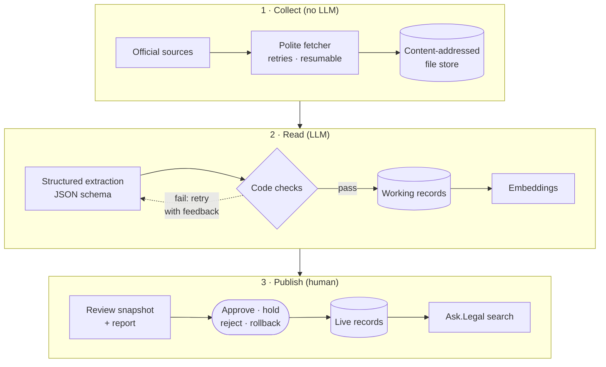

<div align="center">

<picture>
  <source media="(prefers-color-scheme: dark)" srcset="assets/logo-dark.svg">
  
</picture>

### The law, noted up every day.

An LLM-powered pipeline that keeps **Ask.Legal**'s Hong Kong legal search database current:
legislation, gazetted amendments and court judgments, extracted with large language models,
verified by code, and published only after human review.

    

</div>

> [!NOTE]
> This repository is a showcase of a private project. The source code isn't public. I'm happy
> to walk through it on request.

---

## At a glance

<table>
<tr>
<td align="center"><b>62,899</b><br>legislation records<br><sub>2,354 instruments, English + Chinese</sub></td>
<td align="center"><b>~63,000</b><br>judgments collected<br><sub>CFA and CA since 1997, CFI since 2021</sub></td>
<td align="center"><b>17,700+</b><br>legal-point records<br><sub>and growing every night</sub></td>
</tr>
<tr>
<td align="center"><b>1,000+</b><br>judgments read per hour<br><sub>16 parallel LLM workers</sub></td>
<td align="center"><b>$1.27</b><br>to embed 63,000 texts<br><sub>text-embedding-3-small</sub></td>
<td align="center"><b>2 weeks</b><br>first commit to daily production<br><sub>8 → 21 October 2026</sub></td>
</tr>
</table>

<sub>Figures as of 21 October 2026.</sub>

## The problem

Ask.Legal answers legal questions from a search database of Hong Kong law. That database is
only as good as it is current: sections get amended, new judgments are handed down daily,
and earlier cases are doubted or overruled. A legal AI that cites a superseded section or an
overruled case is worse than one that says nothing.

Keeping it current by hand means reading every new judgment, every gazetted amendment, and
working out what each one did to the law already in the database. noteup automates that
work, *noting up* the database every day, while keeping a person in charge of what goes live.

## What it does

- **Legislation.** Parses the official consolidated text of every Ordinance and piece of
  subsidiary legislation into one bilingual record per provision, and re-processes a chapter
  only when its published version changes.
- **Amendment warnings.** An LLM reads each newly gazetted amending instrument to find which
  chapters it changes and when each change commences. Until the consolidated text catches up,
  the affected records carry a warning.
- **Judgments → legal points.** An LLM reads each judgment and extracts its legal points:
  the issue, the proposition, how it was applied, ratio or obiter, the legislation and
  authorities relied on, and supporting quotes with paragraph numbers.
- **Citator.** A second LLM pass finds where a judgment follows, applies, doubts or
  overrules an earlier one, links it to the exact point affected, and applies the effect.
  Overruled points are kept and marked not in force, so the full history survives.
- **Semantic search.** Every record is embedded into pgvector, ready for semantic retrieval
  and retrieval-augmented generation (RAG).
- **Human review.** Changes collect in a working copy. A reviewer freezes them into a
  review, reads a side-by-side report, holds anything doubtful, and approves the rest in one
  transaction. Any approved review can be rolled back.

## Architecture



One Python program and one Postgres database, run daily by a systemd timer. Two commands
do the work: `sync` talks only to the official websites, and `read` does all the LLM work
on what was saved. A website outage and an LLM usage limit never block each other, and
either step can stop at any point and pick up where it left off.

## Engineering highlights

### Trusting LLM output only after code has checked it

LLM answers use strict JSON schemas, and nothing becomes a record until code has verified it:

- every quote appears **word for word** in the paragraph it cites (after whitespace
  normalisation);
- every statute and earlier case the model names appears in the judgment as written;
- every paragraph number exists, and every record fits the 7,000-token limit.

A failed check gets one retry, with the reason fed back and the exact paragraph repeated
for the model to copy from. A second failure marks the judgment "couldn't process" for a
person to see. Downloaded text is passed to the model as clearly delimited data and never
as instructions, which guards against prompt injection from source documents.

### Finding the same reasoning under different case numbers

Batches of near-identical judgments (779 right-of-abode appeals in one year, for example)
would waste LLM budget and flood search with duplicates. noteup fingerprints each
judgment's reasoning, masking party names and incidental numbers but keeping statutory
references, so applying a different section is never a match. **6,173 judgments** are read
once through a representative, which carries a note that the same reasoning was applied in
N other judgments. Translations, corrigenda, sentencing remarks and short orders are set
aside before any LLM call.

### A citator with court-hierarchy rules

Each treatment is resolved by neutral citation, case number or law-report citation. Fixed
rules decide the effect: a note for *followed / applied / approved*, a warning for
*doubted / criticised / disapproved*, and *not in force* for *overruled / reversed*, but
only when the court can do it (the CFA, or a higher court than the one that decided the
point). The LLM chooses the affected point from an enum of real record IDs, so it can't
invent one. Anything unclear goes to a reviewer, not into search.

### Stable identity across re-reads

Record IDs come from the first paragraph a point quotes (`hk-case:2024-hkcfa-12:para48`),
so re-reading a judgment after a prompt change updates records in place rather than
replacing them. That keeps review diffs small and meaningful, and lets holds and treatments
stay attached.

### Publishing that can't half-happen

- A review is frozen in **one SQL statement**, so it is a consistent snapshot even while a
  sync is writing.
- Holds are keyed to a record's **version hash**: a hold lapses automatically if the record
  changes again.
- Approve and rollback each run in **one transaction**, with a change-set hash for the
  audit trail. Rollback refuses if a later review touched the same records.
- **Database roles** enforce the boundary: the sync role cannot write the live table at all.

### Running unattended on a budget

- A Postgres **advisory lock** prevents overlapping runs.
- An **LLM response cache** keyed on prompt version, model and input makes re-runs free.
- **Spending and usage caps** stop reading cleanly and resume on the next run.
- **Reading hours** confine LLM calls to a nightly window.
- New judgments are read **newest first**, so the most useful law arrives first while a
  52,000-judgment backlog works through.
- A run log and a `status` command show runs, failures, backlog, usage and spend at a glance.

```text
$ noteup status
Last runs:
  #11    read                   Wed 21 Oct 19:02  running
  #10    sync                   Wed 21 Oct 19:00     2 min  ok

Waiting:
  judgments to read:      48,426
  Gazette items to read:  0
  treatments to connect:  1,595
  needs a decision:       5
  texts to embed:         10,035
  open review:            none
```

## Data model

Every record shares one shape, ready for hybrid search and RAG:

| Field | Purpose |
|---|---|
| `id` | Stable ID: `hk-leg:cap622g:s5`, `hk-case:2024-hkcfa-12:para48` |
| `text` | A *Context* block (instrument or case, court, date, outcome, ratio or obiter) and the *Passage*. This is what gets embedded |
| `authority_note` | Amendment warnings and treatment notes. Passed to the LLM alongside `text`, not embedded |
| `in_force` | `false` for overruled or reversed points: filtered out of search, kept for history |
| `type`, `source`, `country`, `jurisdiction` | Record kind, link to the official source, and where it applies |

Behind the records, Postgres tables hold every download, run, judgment version, gazette
item, amendment, treatment, LLM call (with tokens and cost), review and held change.

## Quality

- **73 tests** run against a real Postgres database, with saved source pages and recorded
  LLM answers, so they're fast, deterministic and free.
- A **hand-checked golden set** of judgments measures extraction quality (points and
  treatments matched, missed and extra), re-run whenever a prompt or model changes.
- Parsers **fail loudly** on anything unexpected in the official formats instead of
  silently dropping text.

## Tech stack

**Python 3.12** · **PostgreSQL 17** + **pgvector** · **psycopg 3** · **Azure OpenAI**
(chat and `text-embedding-3-small`) or the **OpenAI Codex CLI** as the LLM backend ·
**tiktoken** · **pypdf** · **uv** · **pytest** · **Docker** · **systemd**

About 4,200 lines of application code and 1,700 lines of tests. No frameworks and no extra
services: one program and one database, by design.

## Status and roadmap

In production since **21 October 2026**, running every night.

- [x] Hong Kong legislation, amendment warnings, and CFA, CA and CFI judgments
- [x] Citator with court-hierarchy rules; overruled law kept and marked
- [ ] Connecting Ask.Legal's search to the live table
- [ ] More common law jurisdictions
- [ ] Running in the cloud (Azure Container Apps)
- [ ] Reviews from Ask.Legal's admin portal

## About

Designed and built by [@stevw-repo](https://github.com/stevw-repo) for Ask.Legal.
The code is private; I'm glad to walk through the design and source in an interview.
