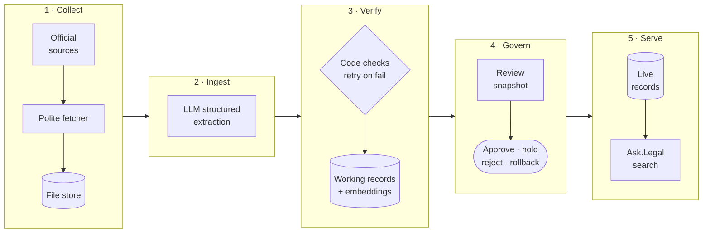
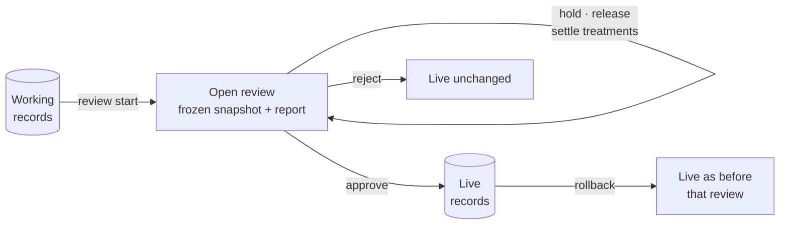

<div align="center">

<picture>
  <source media="(prefers-color-scheme: dark)" srcset="assets/logo-dark.svg">
  
</picture>

### The law, continuously integrated.

noteup is a **continuous legal intelligence engine**. Instead of a static snapshot, it
treats the law as a living stream: new legislation, amendments and judgments are ingested
as they're published, read by **frontier large language models**, **verified against the
source**, and woven into a **semantically searchable knowledge base** in which every
authority carries its own up-to-date history. Humans stay in the loop: nothing goes live
without approval. Built for [**Ask.Legal**](https://ask.legal/).

     


[Why noteup](#why-noteup) · [What it does](#what-it-does) · [Coverage](#coverage) · [Applications](#applications) · [Architecture](#architecture) · [Review](#review-workflow) · [Deployment](#deployment) · [Engineering](#engineering-highlights) · [Roadmap](#roadmap)

</div>

> [!NOTE]
> This repository is a showcase of a private project. The source code isn't public for commercial reasons. I'm happy
> to walk through it on request.

---

## Why noteup

The law doesn't stand still. Sections are amended, new judgments are handed down every
day, and cases that were good law last year are doubted or overruled. Lawyers call
checking for this *noting up*. Done by hand, it's slow and easy to miss.

Legal search tools and AI assistants have the same problem, only silently. A database
built once starts going out of date the next day, and an assistant that confidently
cites a repealed section or an overruled case is worse than one that says nothing.

noteup was built for **Ask.Legal**, to keep its Hong Kong legal search database current. It
does the noting up for a whole database, continuously:

- **Continuously current.** New legislation, amendments and judgments are ingested as
  they're published, and made searchable by meaning, not just keywords.
- **History-aware.** Every authority knows what has happened to it since: amended,
  followed, doubted or overruled.
- **Human-in-the-loop.** AI does the reading, people sign off, and every change is
  reversible.

## What it does

**For legislation**

- Keeps every provision up to date, in each official language.
- Reads newly published amendments to work out what changes and when, and warns when an
  amendment has come into force but the official consolidated text hasn't caught up yet,
  so nobody relies on wording that has already changed.

**For case law**

- Uses natural language processing to turn each judgment into its legal points: the
  issue, the proposition, how it was applied, and whether it was necessary to the decision
  or said in passing.
- Backs every point with the court's own words and paragraph numbers, checked word for
  word against the judgment.
- Recognises how later judgments treat earlier ones, and links each treatment to the
  exact point affected:

| When a later judgment… | noteup… |
|---|---|
| follows, applies, approves or explains a point | notes it, e.g. *Applied in X v Y at [55].* |
| doubts, criticises, disapproves, limits or declines to follow it | adds a warning to the point |
| overrules it | keeps the point, marks it **not in force**, and says why |
| affirms or reverses the judgment on appeal | notes it, or warns, on every point of the judgment |
| distinguishes it | leaves it as it is |

Overruled law isn't deleted. Your search can leave it out by default and still show a
case's full history when it's needed.

- Recognises what judgments do to legislation, and puts a warning on a section a court
  has held inconsistent with the Basic Law or the Bill of Rights, and a note on one it
  has read down.
- Recognises new laws that reverse, change or codify a court decision, from the
  Government's own explanation of each Bill, and warns on the points affected.
- Links every legal point to the sections of legislation it reads, and every treatment
  to the judgments at both ends, so you can follow the law from record to record.

**Human-in-the-loop governance**

- A review report shows every proposed change side by side with what's live now.
- Reviewers approve in batches, hold back anything doubtful, settle the few cases the
  model couldn't decide, and add treatments it missed.
- The same review steps run from the command line or an admin web portal.
- A published update can be rolled back in one step.

## Coverage

| Jurisdiction | Legislation | Case law | Status |
|---|---|---|---|
| Hong Kong | Ordinances and subsidiary legislation, with amendment warnings and court treatments | Court of Final Appeal, Court of Appeal, Court of First Instance | Running daily |
| Other common law jurisdictions | — | — | Planned |

noteup is built so a new jurisdiction is a new set of sources, not a new system: the
records, the treatment rules and the review all stay the same. Overseas cases and
legislation that Hong Kong judgments cite are already kept as placeholders, so they link
up once those jurisdictions are added.

## Applications

noteup provides the data layer: current, structured, verified law with semantic
embeddings. These are some of the applications it is designed to support.

**For lawyers**

- **Semantic legal search.** Ask in plain language, for example *"When can a tenant withhold
  rent for disrepair?"*, and get the relevant provisions and case points, in English or
  Chinese.
- **Citator.** Look up a case or section and see everything that has happened to it since,
  and follow the chain of treatments either way.
- **How a section is read.** See the judgments that apply, interpret or read down a
  section, and the points they make about it.
- **Authority checking.** Scan a submission, opinion or contract for authorities that have
  since been overruled, repealed or amended.
- **Current awareness.** Alerts when the law changes in a practice area, or in the law a
  client relies on.
- **Research memos.** First drafts grounded in current law, with pinpoint citations.
- **Precedent by facts.** Each point records the facts needed to understand it, so you can
  search by situation, not just by doctrine.

**For legal technology and in-house teams**

- **Retrieval-augmented generation (RAG).** Ground LLM assistants in current law, with
  citations to the exact paragraph and warnings that keep them from relying on bad law.
- **Graph retrieval.** Follow links from a point to the sections it reads, the cases it
  relies on and the cases that later treated it, instead of relying on similarity alone.
- **Regulatory change tracking.** What changed in the rules that matter to you, and when
  it takes effect.
- **Case law analytics.** Which points are most followed, which are doubted, and how
  authority flows between courts.
- **Comparative law.** As coverage grows, how different common law jurisdictions answer
  the same question.

## Architecture



One Python program and one Postgres database, run daily by a systemd timer. Two commands
do the work: `sync` talks only to the official websites, and `read` does all the LLM work
on what was saved. A website outage and an LLM usage limit never block each other, and
either step can stop at any point and pick up where it left off.

### What you get

One record per provision or legal point, in Postgres with pgvector:

| Field | |
|---|---|
| `text` | The provision or point with its context, ready to embed and show |
| `authority_note` | Warnings and treatment notes. Pass it to your model alongside `text` |
| `in_force` | `false` for overruled or reversed points. Filter on it in search |
| `id`, `source`, `type`, `jurisdiction` | Stable ID (`hk-leg:cap622g:s5`, `hk-case:2024-hkcfa-12:para48`), link to the official source, and where it applies |

Around the records sits a citation graph, published through the same review:

- **Parents.** Every record belongs to a judgment or an Ordinance, with its title,
  citation, court, date and official link. Cases and enactments that are cited but not
  held (overseas, or older than the collection) get placeholders, so no link ever
  points nowhere.
- **Links.** One per treatment, from the later judgment (and its point, where one point
  quotes the paragraph) to the earlier point or judgment, with its kind and the court's
  words; and one from each case point to each section of legislation it reads.

Embeddings are created for you, so records are ready for semantic search. LLM output is
never trusted as is: it's checked against the source before it becomes a record, and
published text only changes through an approved review.

### Workflow

```bash
noteup sync      # collect what's new from the official sources (no LLM calls)
noteup read      # extract with the LLM, check, build records and embeddings
noteup status    # runs, failures, what's waiting, usage and spend

noteup review start      # freeze the changes and write a side-by-side report
noteup review approve    # publish them (or hold, reject, rollback)
```

A systemd timer runs `sync` and `read` every night.

## Review workflow

Every change reaches the live table through a review. Reviews can run as often as the
team likes; syncing carries on in the background, and new changes simply wait for the
next one.



1. **Start.** Every difference between Working and Live (each add, change and removal) is
   frozen into a review in a single statement, and a report is written as HTML and Markdown.
2. **Read the report.** It shows every change side by side with what's live now, plus
   sources that failed, items the LLM couldn't process, treatments that need a decision,
   possible corrected versions of judgments, and anything still missing an embedding.
3. **Hold and settle.** Reviewers hold single records with a reason; a hold carries over
   to later reviews until the record changes again. Treatments the model couldn't classify
   are settled by hand, and their effect joins the next review.
4. **Approve or reject.** Approval applies every change that isn't held in one
   transaction, and records who approved it, when, and a hash of the exact change set. It
   refuses if any live record would be left without an embedding. Rejection leaves Live
   untouched, with a reason on record.
5. **Roll back.** Any approved review can be undone, restoring Live exactly as it was. It
   refuses if a later review changed the same records, so history can't be scrambled.

```bash
noteup review start                       # freeze the changes, write the report
noteup review hold <record> --reason "…"  # keep one change out
noteup treatment set <id> <kind|none>     # settle a treatment the model couldn't decide
noteup review approve                     # or: reject --reason "…"
noteup review rollback <review>           # undo an approved review
```

Every step is a Postgres function, so the command line and an admin web portal run
exactly the same code. The portal lists each judgment's points to choose from when a
reviewer settles a treatment or adds one the model missed, so nobody types a record ID.
Each call is one statement, so it happens completely or not at all.

## Deployment

One program and one database, so deployment stays small. The same code runs locally or
in the cloud; only settings change.

| | Today | Planned |
|---|---|---|
| **Scheduling** | systemd timer on a Linux machine, nightly | Azure Container Apps Job on a schedule |
| **Database** | Azure Database for PostgreSQL 17 with pgvector | (same) |
| **File store** | Local disk, content-addressed | Azure Files share |
| **LLM** | OpenAI Codex CLI, or Azure OpenAI | Azure OpenAI |
| **Embeddings** | Azure OpenAI `text-embedding-3-small` | Azure OpenAI `text-embedding-3-small` |

- **Configuration** is all environment variables; secrets stay out of the repository.
- **Schema upgrades** are additive and idempotent: `noteup db init` adds whatever is
  missing, so updating is "pull, init, run".
- **Least privilege** in the database: the sync role writes everything except the live
  tables, only approve and rollback use the role that can publish, and the portal's role
  can run the review functions but write no table itself.
- **No export step.** The search application reads the live tables directly, so what
  reviewers approve is exactly what users get.

## Engineering highlights

### Trusting LLM output only after code has checked it

LLM answers use strict JSON schemas, and nothing becomes a record until code has verified it:

- every quote appears **word for word** in the paragraph it cites (after whitespace
  normalisation);
- every statute and earlier case the model names appears in the judgment as written;
- every paragraph number exists, and every record fits the 7,000-token limit.

A failed check gets one retry, with the reason fed back and the exact paragraph repeated
for the model to copy from. A second failure marks the judgment "couldn't process" for a
person to see. Downloaded text is passed to the model as clearly delimited data and never
as instructions, which guards against prompt injection from source documents.

### Deduplication with reasoning fingerprints

Batches of near-identical judgments (779 right-of-abode appeals in one year, for example)
would waste LLM budget and flood search with duplicates. noteup fingerprints each
judgment's reasoning, masking party names and incidental numbers but keeping statutory
references, so applying a different section is never a match. Each group is read once
through a representative, which carries a note that the same reasoning was applied in N
other judgments. Translations, corrigenda, sentencing remarks and short orders are set
aside before any LLM call.

### A rule-grounded AI citator

Each treatment is resolved by neutral citation, case number or law-report citation. Fixed
rules decide the effect: a note for *followed / applied / approved / explained*, a warning
for *doubted / criticised / disapproved / limited / not followed*, and *not in force* for
*overruled*, but only when the court can do it (the CFA, or a higher court than the one
that decided the point). Reversal and affirmance on appeal apply to the whole judgment,
and a reversal that is itself reversed says so. The LLM chooses the affected point from
an enum of real record IDs, given the whole paragraph that treats it, so it can't invent
one. Anything unclear goes to a reviewer, not into search.

The same read lists what the court does to legislation (applies, interprets, reads down,
holds inconsistent with the Basic Law or the Bill of Rights, upholds), and a separate read
of the Government's explanation of each new Bill finds the court decisions the law
reverses, changes or codifies. All three feed one treatments table and the same rules.

### Matching legislation references in code

Each point names the legislation it relies on as the court wrote it: "s.52(3) of the
Companies Ordinance", "RHC O.53 r.4", "BORO art.11", "《基本法》第二十四條". Code, with no
model calls, matches these to the right section record: by Cap. number, English or
Chinese title, common short names, and the date of the judgment (the old and new
Companies Ordinances share a name). A reference that names a place or calls itself an
Act is overseas and is never matched to a Hong Kong Ordinance, even one with the same
words: the *Theft Act 1968* is not the *Theft Ordinance*. Enactments we don't hold get
placeholders with their place, and every reference is matched again on each run, so
they link without any re-reading once that legislation is added.

### Stable identity across re-reads

Record IDs come from the first paragraph a point quotes (`hk-case:2024-hkcfa-12:para48`),
so re-reading a judgment after a prompt change updates records in place rather than
replacing them. That keeps review diffs small and meaningful, and lets holds and treatments
stay attached.

### Transactional, reversible publishing

- A review is frozen in **one SQL statement**, so it is a consistent snapshot even while a
  sync is writing.
- Holds are keyed to a record's **version hash**: a hold lapses automatically if the record
  changes again.
- Approve and rollback each run in **one transaction**, with a change-set hash for the
  audit trail. Rollback refuses if a later review touched the same records.
- **Database roles** enforce the boundary: the sync role cannot write the live table at all.

### Autonomous, budget-aware operation

- A Postgres **advisory lock** prevents overlapping runs.
- An **LLM response cache** keyed on prompt version, model and input makes re-runs free.
- **Spending and usage caps** stop reading cleanly and resume on the next run.
- **Reading hours** confine LLM calls to a nightly window, and rate limits are waited out
  within it rather than ending the night.
- Judgments are read **in parallel**, with each one's points and treatments together, so
  a run that stops early never leaves a judgment half read.
- A lost database connection stops the run cleanly, and the run is still recorded.
- Judgments are read **newest first**, so the most useful law arrives first while the
  historical backlog works through.
- A run log and a `status` command show runs, failures, backlog, usage and spend at a glance.


## Quality

- **162 tests** run against a real Postgres database, with saved source pages and recorded
  LLM answers, so they're fast, deterministic and free.
- A **hand-checked golden set** of judgments measures extraction quality (points and
  treatments matched, missed and extra), re-run whenever a prompt or model changes.
- Parsers **fail loudly** on anything unexpected in the official formats instead of
  silently dropping text.

## Tech stack

**Python 3.12** · **PostgreSQL 17** + **pgvector** · **psycopg 3** · **Azure OpenAI**
(chat and `text-embedding-3-small`) or the **OpenAI Codex CLI** as the LLM backend ·
**tiktoken** · **pypdf** · **uv** · **pytest** · **Docker** · **systemd**

About 6,400 lines of application code and 3,100 lines of tests. No frameworks and no extra
services: one program and one database, by design.

## Roadmap

- [x] Hong Kong legislation, amendment warnings and superior court judgments
- [x] Treatment tracking, with overruled law kept and marked
- [x] Treatments of legislation, and new laws that reverse or change case law
- [x] A citation graph: parents and links between judgments, points and sections
- [x] Review steps as database functions, shared by the command line and an admin portal
- [x] Database in the cloud
- [ ] More common law jurisdictions
- [ ] Hong Kong judgments from all years and courts
- [ ] Scheduled runs in the cloud

## About

Designed and built by [@stevw-repo](https://github.com/stevw-repo) for Ask.Legal.
The code is private; I'm glad to walk through the design and source in an interview.
